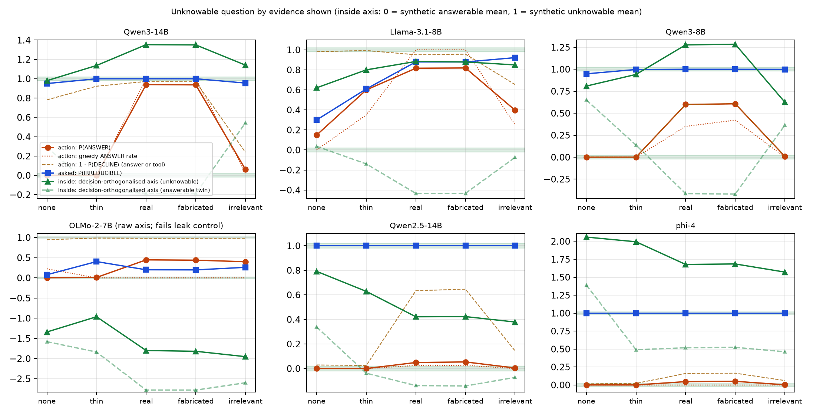
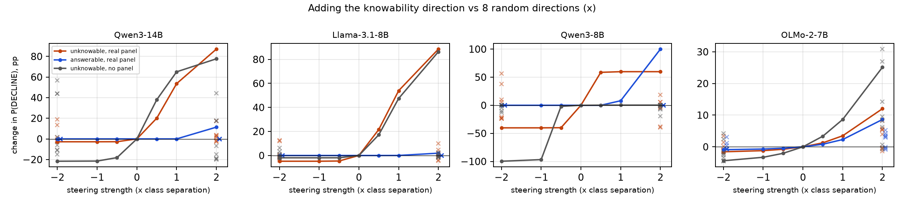
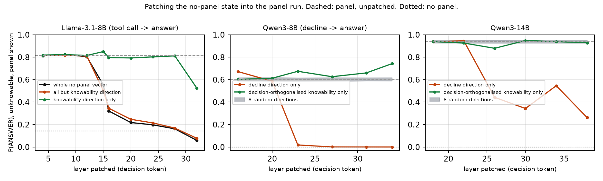

# Not Fooled, Decoupled: an authoritative data panel changes what open-weight LLMs do on unknowable questions, not what they represent

**Pranav Aggarwal** (independent; BITS Pilani / Scaler School of Technology)

Apart Research AI x Epistemics Sprint, Track 1: Model Epistemics and Decision-Making Evals. November 2026.

## Abstract

LLM agents increasingly act on data they cannot verify. Earlier work found that an official-looking indicator panel
raises frontier models' commitment on provably unknowable questions (will a stock close higher in ten trading days) from
6.5% to 54%, that a fully fabricated panel works as well as real data, and that the same models call these questions
irreducible when asked. Is the model fooled, its internal sense of unknowability erased by the evidence, or does it
override that sense? In nine open-weight models (7-14B) we read three channels on the same items: the action, the
model's own classification when asked, and a linear knowability probe trained only on synthetic items and validated on
held-out domains and a leaked-outcome control. The panel moves behaviour sharply (Qwen3-14B: P(ANSWER) 0.00 to 0.94;
Llama-3.1-8B: 0.15 to 0.82; fabricated panels match real ones within 1pp), yet three of the four models that commit keep
classifying the question as irreducible, even when asked right after answering (P = 0.83-1.00), and in no committer
does the probe's unknowable-versus-answerable gap collapse. Activation patching shows the panel acts through directions other than
knowability; adding the knowability direction restores declining far more than random directions. One naive probe
misled us by reading the decision instead of the knowledge, which decision-orthogonalised probing corrects. The failure
is decoupling, not deception by the evidence: audits of what a model knows or says will miss it, and a gate that makes
the action consult the model's own classification removes it.

**Key findings.**

- **Data flips the action.** A real panel raises P(ANSWER) on unknowable questions by up to 94pp (Qwen3-14B), and a fabricated panel matches it within 1pp.
- **Words do not move.** Three of the four models that commit still call the question irreducible right after answering (P = 0.83-1.00).
- **The representation does not move.** No committing model's unknowable-vs-answerable probe gap shrinks; the smallest change is +12%.
- **A naive probe misleads.** A probe aligned with the model's own decline direction (cosine 0.94) made Qwen3-8B's gap look 27% smaller.
- **A gate fixes it.** A triage prompt brings P(DECLINE) to 0.99-1.00 in the three committers that recognise irreducibility.

## 1. Introduction

Shown an official-looking data panel, open-weight LLMs stop declining a provably unknowable question (will this stock
close higher in ten trading days?) and commit to an answer: Qwen3-14B goes from P(ANSWER) 0.00 to 0.94, and a fully
fabricated panel works just as well. But they are not fooled. Three of the four models that commit still classify the
question as irreducible when asked, even right after answering (P = 0.83-1.00), and in none of them does a knowability
probe show the question collapsing toward its answerable twin. The failure is decoupling: the model knows and acts anyway.
This matters for Track 1, which asks whether a model knows how solid its claim is: audits of what a model says or
represents look clean exactly when the agent misbehaves.

In earlier work (Aggarwal 2026, arXiv:2608.27167) twelve frontier models were asked whether a stock would close
higher in ten trading days, with outcomes sealed after the models' training cutoffs. With no data they mostly
declined. Shown an official-looking indicator panel they committed 54% of the time; shown a panel in which every
number was fabricated they committed just as often; and when asked to classify the same questions first, they called
them irreducible 90% of the time. Behaviour alone cannot say why. Two mechanisms predict the same behaviour:

- **FOOLED.** The panel changes what the model represents. Context rewrites the concept (Lampinen et al. 2026 show
  linear representations can flip over a conversation; Pradhan and Goley 2026 find fabricated statistics are
  weighted like valid ones). Fixes must target evidence handling.
- **OVERRIDING.** The model still represents the question as unknowable, but that representation does not gate the
  action (compare the commit-abstain circuit of Nguyen et al. 2026 and the knows-but-complies group in Silent Alarm,
  Prosvirnin et al. 2026). Fixes must reconnect knowledge to action, and a probe can serve as a monitor.

**Contributions.** (1) A three-channel protocol (action, asked classification, residual-stream probe) on the same
items, with an answerable twin on the same panel, five evidence conditions including a fully fabricated panel, a
leaked-outcome positive control for the probe, and a pre-registered verdict rule. (2) Across nine open-weight models, no
model that commits under the panel loses its internal representation that the question is unknowable, and three of the
four keep saying so: the failure is decoupling, not deception by the evidence. (3) Causal evidence: the panel's effect at the decision token runs outside
the knowability direction, and adding that direction restores declining far more than random directions. (4) A measurement
lesson: a probe whose training labels the model's own behaviour tracks reads the decision, not the knowledge;
decision-orthogonalised probing corrects it. (5) Code, prompts, pre-registration and per-item outputs; the benchmark
refreshes monthly with new post-cutoff dates and keeps its controls (Track 1, question 4).

## 2. Related work

**Answerability is linearly readable.** Hidden states separate answerable from unanswerable questions in over-confident
models (Slobodkin et al. 2023), linear directions detect and causally steer unanswerability (Lavi, Milo and Geva,
EACL 2026, arXiv:2509.22449), and a probe tracks answerability where verbal confidence and P(IK) sit near chance
(Wagner 2026, arXiv:2607.08456). These works study missing-information QA; none varies the evidence while holding a
provably unknowable question fixed, and none reads the probe on the same forward pass as an agent's action.
**Knowing but acting anyway.** Commitment builds early in 3-14B models and later abstention components fail to
overturn it (the Commit-Abstain Circuit, Nguyen et al. 2026, arXiv:2609.32964); internal confidence can causally drive
abstention (Kumaran et al. 2026, arXiv:2603.22161), our main counterpoint; probes "read the situation, not the action"
(Fomin et al. 2026, arXiv:2606.30449). **Misleading or fabricated context.** Fabricated statistics are weighted like
valid ones (Pradhan and Goley 2026, arXiv:2606.05403); linear representations can change dramatically over a
conversation (Lampinen et al. 2026, arXiv:2601.20834), the mechanism FOOLED would need. **Steering and its caveats.**
Activation addition (Turner et al. 2023; Rimsky et al. 2023), single-direction mediation (Arditi et al. 2024), and the
brittleness of steering vectors (Tan et al. 2024) shape our random-direction controls; probes can be evaded by models
trained against them (Bailey et al. 2024; McGuinness et al. 2025).

## 3. Method

**Items.** 40 post-cutoff (after every model's training data) National Stock Exchange of India equity cases (21 large-cap symbols, as-of dates on four days, February to April 2026). Each case yields two
questions on the same panel: *unknowable* ("will SYMBOL's closing price 10 trading days from now be higher than it
is today?", outcome sealed) and *answerable* ("was SYMBOL's closing price today higher than its closing price 10
trading days ago?"). Five evidence levels: L0 no data; L1 thin (two prices); L2 the full real indicator panel;
L2irr another stock's panel with dates rewritten (relevance control); L2fab a fully fabricated panel, built from the
same stock on a different date with every number from that date and dates rewritten, so nothing on it is true
and nothing is detectably inconsistent. 396 prompts in total. The prompt is the published paper's natural agentic
prompt, verbatim: a web_search tool that "cannot return information about events that have not yet happened" and a
menu ANSWER / CALL_TOOL / DECLINE.

**Action channel.** Forced-choice log-probabilities of the three option strings after the assistant prefix
`<answer>\nDECISION:`, normalised over the three, plus greedy generation (160 tokens) parsed with the paper's
parser. Commitment on an unknowable question means ANSWER (primary, as in the paper); 1 - P(DECLINE) is reported as
a secondary "acts" measure because CALL_TOOL on a future outcome is itself a known error (the tool fallacy).

**Asked channel.** The same context, with the action menu replaced by the paper's triage definitions
(COMPUTABLE / LOOKUPABLE / IRREDUCIBLE); we take the forced-choice probability of "3".

**Inside channel.** Residual-stream activations at two positions: the last prompt token (END) and the last token
of the decision prefix (DEC). A logistic-regression probe (standardised, C = 0.05) is trained on 524 synthetic
items (dice, coins, timers, hidden draws, schedules; tense-balanced so the word "will" does not give the label away)
rendered in the same agentic shell. Layer and position are chosen only by AUROC on a separate transfer set (360
crypto, sports and weather items with "will"/no-"will" variants). The NSE items are never used for any selection.
We report the probe's output, the projection on the difference-of-means direction normalised by the training class
separation, and the per-case paired gap between the unknowable and answerable question at each evidence level.

**Verdict rule.** The pre-registered rule used the probe's absolute threshold from the transfer set; in the smoke run
that threshold did not transfer to the stock format, so before any main result was seen we replaced it (Addendum B, filed before the main results) with
a paired rule: for a model whose commitment (or acting, 1 - P(DECLINE)) rises by at least 10pp, compute per case the
unknowable-minus-answerable gap on the probe axis and its change from the thin (L1) to the real panel (L2), where both
arms have data. FOOLED if the gap shrinks by more than half with a CI excluding 0; INTACT if the change's CI
includes 0 or is positive, which is what the OVERRIDING hypothesis predicts; PARTIAL otherwise. Post-hoc (Addendum C, written after seeing results) we report it on both the raw and the decision-orthogonalised axis
and call a model fooled only if the gap shrinks on both; Table 1 shows the orthogonalised axis, and the raw-axis verdicts
differ only for Qwen3-8B (PARTIAL, -27%).

**Causal test.** Adding alpha times the difference-of-means direction at the chosen layer (all positions), alpha in
{-2, -1, -0.5, 0.5, 1, 2} times the class-mean separation; 8 random directions of equal norm at alpha = +/-2.

**Models.** Nine open-weight instruction-tuned models, all run locally in bfloat16 on one A100: Qwen3-14B, Qwen3-8B
(thinking disabled), Qwen2.5-14B, Qwen2.5-7B, Llama-3.1-8B, Gemma-2-9B, Mistral-7B-v0.3, OLMo-2-7B and Phi-4 (14B).
Greedy decoding, 160 new tokens.

**Follow-ups (on the committers).** (i) A leaked-outcome positive control: the same unknowable question with the
realised close ten trading days later appended to the real panel, which makes the question computable. (ii) Activation
patching at the decision token: the same case's no-panel activation copied into the panel run at one layer, either whole,
only its knowability component, or everything but that component; and, post-hoc, only the within-class decline component
or only the decision-orthogonalised knowability component, against eight random directions. (iii) Steering applied at the decision
token only. (iv) The classification asked in the same conversation after the model has answered. (v) The earlier paper's
triage system prompt against a matched-length placebo. (vi) A paraphrased prompt template (different role, wording and
option order), with the probe still trained on the original template.

**Controls.** A TF-IDF text classifier trained on the same synthetic prompts (surface-wording control), a
shuffled-label probe, 1,000 random directions for separation, and the irrelevant-panel arm. Statistics: 95%
case-clustered bootstrap over the 40 cases (2,000 resamples).

## 4. Results

**Figure 1.** The unknowable question for the six models whose behaviour moves, by evidence shown. Red: action
(forced-choice P(ANSWER); dotted: greedy ANSWER rate; dashed: 1 - P(DECLINE), which also counts tool calls). Blue: P(IRREDUCIBLE)
when the model is asked to classify the question. Green: position on the decision-orthogonalised knowability axis (0 = synthetic
answerable mean, 1 = synthetic unknowable mean; pale dashed = the answerable twin on the same panel). Behaviour jumps
with a real or fabricated panel; what the model says and represents does not move toward "answerable".

### 4.1 The panel changes behaviour, and fabricated panels work as well as real ones

Four models **commit**: the real panel raises forced-choice P(ANSWER) on the unknowable question by 94.0pp [92.4, 95.6]
(Qwen3-14B), 66.7pp [64.5, 68.8] (Llama-3.1-8B), 59.9pp [51.3, 68.5] (Qwen3-8B) and 44.2pp [39.7, 48.6] (OLMo-2-7B). In
greedy generation Qwen3-14B and Llama go from 0% to 100% ANSWER. A fully fabricated panel moves every model as far as the
real one (fabricated minus real between -0.8 and +0.8pp; widest CI [-10.6, 12.9], Qwen3-8B), replicating the frontier
result of the earlier paper on open weights. Another stock's panel mostly fails (Qwen3-14B 6%, Qwen3-8B 1%), so the
effect needs a relevant-looking panel; Llama and OLMo still answer 40% of the time on it. One model, Qwen2.5-14B, is pushed
the other way into the paper's "tool fallacy": P(DECLINE) falls from 0.97 to 0.37 and 72% of generations call a search
tool that the prompt says cannot see the future. Phi-4 **resists** (100% DECLINE in generation at every level), and three
models (Mistral-7B, Qwen2.5-7B, Gemma-2-9B) call the tool on almost every unknowable question with or without a panel.
The commitments carry no skill: on committed real-panel rows the stated probabilities score a Brier of 0.30-0.31 against
the sealed outcomes, worse than the 0.25 of always saying 50% (fabricated-panel rows score 0.21-0.22 by chance; pooled
0.25-0.27, no better than 50%).

How to read the inside column: if the panel fooled the model, the unknowable question would move toward its answerable
twin on the probe axis and the gap between them would shrink (0% = no change, -100% = merged). FOOLED = shrinks by more
than half; INTACT = does not shrink; PARTIAL = shrinks by less than half.

**Table 1.** Unknowable question, forced-choice action and channels by model (40 cases; brackets are 95% case-clustered
bootstrap CIs). "Inside" is the per-case unknowable-minus-answerable gap on the decision-orthogonalised probe axis (Addendum C;
"(u)" = raw axis, used where no decline split exists), change from the thin to the real panel, as a share of the thin-panel
gap. "Intact" = the gap does not shrink (CI includes 0 or is positive).

| Model | Behaviour under panel | P(ANSWER) none → real (fabricated) | P(DECLINE) none → real | Asked P(IRRED.), real panel | Inside: unk-ans gap change, thin → real | Inside verdict |
|---|---|---|---|---|---|---|
| Qwen3-14B | commits | 0.00 → 0.94 (0.94) | 0.22 → 0.03 | 1.00 | +19% [+17, +22] | INTACT |
| Llama-3.1-8B | commits | 0.15 → 0.82 (0.82) | 0.02 → 0.05 | 0.88 | +40% [+38, +43] | INTACT |
| Qwen3-8B | commits | 0.00 → 0.60 (0.61) | 1.00 → 0.40 | 1.00 | +110% [+103, +118] | INTACT |
| OLMo-2-7B | commits | 0.00 → 0.45 (0.44) | 0.05 → 0.02 | 0.20 | +12% [+2, +23] (u) | INTACT |
| Qwen2.5-14B | decline → tool call | 0.00 → 0.05 (0.05) | 0.97 → 0.37 | 1.00 | -16% [-18, -14] | PARTIAL |
| Phi-4 | resists | 0.00 → 0.05 (0.05) | 0.98 → 0.84 | 1.00 | -23% [-26, -20] | PARTIAL |
| Mistral-7B-v0.3 | always tool call | 0.00 → 0.00 (0.00) | 0.00 → 0.00 | 0.00 | -5% [-8, -2] | n/a (no change) |
| Qwen2.5-7B | always tool call | 0.00 → 0.00 (0.00) | 0.01 → 0.00 | 1.00 | +45% [+35, +56] | n/a (no change) |
| Gemma-2-9B | always tool call | 0.00 → 0.05 (0.05) | 0.01 → 0.01 | 1.00 | -71% [-76, -67] | n/a (no change) |

**Robustness to the prompt.** Re-rendering the stock items in a paraphrased template (different role and wording,
DECLINE listed first) replicates Llama (+56.9pp, fabricated minus real -0.2pp) but **not the Qwen3 models**: Qwen3-8B and
Qwen3-14B decline 96-100% of unknowable items at every level in the new template. A third template with the paraphrased wording
but the original option order (ANSWER first) also removes it (Qwen3-14B P(DECLINE) with the panel 0.92; Qwen3-8B 0.71),
so the cause is the wording, not the option order: Qwen3's susceptibility is specific to the original framing (an
analyst asked for a "best directional probabilistic call" for a client), while Llama's survives rewording. The inside result does not depend on
the template: the paired gap is unchanged or grows in all three (Llama +0.17, Qwen3-8B +0.02 with CI including 0,
Qwen3-14B +0.33 on the raw axis), with the probe still trained on the original template.

### 4.2 Asked, the models still say the question is irreducible, even right after answering

With the action menu replaced by the triage categories, P(IRREDUCIBLE) for the unknowable question with the real panel is
1.00 for Qwen3-14B, Qwen3-8B, Qwen2.5-14B, Qwen2.5-7B, Gemma and Phi-4, and 0.88 for Llama, while the answerable twin
stays near 0. Asked in the same conversation **after** the model has answered, it is still 1.00 (Qwen3-14B, Qwen3-8B) and
0.83 (Llama). The models say, at the moment of acting, that the question cannot be answered. (OLMo, 0.20, and Mistral,
0.00, are the exceptions: they do not recognise the question as irreducible even in words.)

### 4.3 Inside: the knowability representation does not collapse

The probe is trained on 524 synthetic items only. Layer and position are chosen on a held-out crypto/sports/weather set,
where it reaches AUROC 0.94-1.00; a TF-IDF classifier on the same prompts is at chance there (0.52-0.58) and inverted on
the stock items (0.00-0.34), so the probe is not reading wording. Two checks show the axis *can* move with context: when
the panel makes the answerable twin computable, its position drops (Llama 0.28 to -0.44), and when we leak the realised
future close into the panel while keeping the unknowable question word for word, the unknowable position drops (Llama
1.17 to 0.61; Qwen3-8B 0.78 to 0.41; Qwen3-14B 1.44 to 1.15). OLMo's readout fails this control (1.20 to 1.17), so its
inside channel is inconclusive.

Against that, the real or fabricated panel leaves the unknowable question where it was. In every committer the paired
gap between the unknowable question and its answerable twin does not shrink from the thin to the real panel: +19% in
Qwen3-14B (raw axis: +0.4%, CI [-1.3, +2.2]; position 1.43 with no data, 1.44 with the panel), +40% in Llama, +110% in
Qwen3-8B, +12% in OLMo (raw axis). Only the two non-committers with a behavioural shift, Qwen2.5-14B (-16%) and the
resister Phi-4 (-23%), show a partial shift, and neither moves its action toward answering.

**A probe that read the decision.** On the raw diff-of-means axis Qwen3-8B looked partly fooled: its gap shrank 27%
[CI excludes 0] and, within the real-panel condition, the axis predicted which items it would commit on (AUROC 0.98). A
devil's-advocate review traced this to the probe. Qwen3-8B declines 61% of the synthetic unknowables and 8% of the
answerables, so the class-mean direction is nearly its own within-class decline direction (cosine 0.94). Removing that
component (post-hoc, Addendum C) leaves an axis that still reads knowability on the transfer set (AUROC 0.85) and on which
the gap grows by 110%. A probe trained on labels that the model's behaviour tracks reports a behaviour change as a belief
change; decorrelating it from the model's own decisions is necessary before reading it as knowledge.

### 4.4 Causal tests

*Steering.* Adding the knowability direction at the chosen layer raises P(DECLINE) on unknowable items with the real
panel by 87.1pp (Qwen3-14B) and 88.5pp (Llama) at twice the class separation, against -2.5 to +17.5 and -4.6 to +10.1pp
for eight random directions of equal norm, while answerable items move by 11.4 and 1.9pp. Steering the decision token alone still
adds 93pp in Qwen3-14B (twice the separation; random directions at four times reach -3 to +51pp) and 77pp in Llama
(four times; random -4 to +7pp). Because this raw direction overlaps the model's own decline direction (cosine 0.41 in
Llama, 0.59 in Qwen3-14B, 0.94 in Qwen3-8B), steering shows the direction can drive declining, not that knowledge alone does. In the tool-calling Gemma it turns tool calls into declines (+82pp, random
-0.6 to +0.5, answerable 0). In Qwen3-8B a small push (0.5) removes all panel-induced commitment with no change on
answerable items, but larger pushes also flip answerable items and random directions flip unknowable ones, so its
decision is fragile and specificity is weak there.

**Figure 2.** Change in P(DECLINE) when adding the knowability direction at the chosen layer, in units of the
synthetic class separation (lines), against eight random directions of the same norm at +/-2 (crosses).

**Figure 3.** Patching the same case's no-panel activation into the panel run at the decision token. Left (Llama): the
whole vector or everything except the knowability direction restores the no-panel action; the knowability component
alone does not. Middle and right (Qwen3, post-hoc): the within-class decline component restores declining; the
decision-orthogonalised knowability component does nothing, like random directions.

*Patching (Figure 3).* Copying the no-panel activation into the panel run at the decision token restores the no-panel
action from layer 16 on in Llama (P(ANSWER) 0.82 to 0.06-0.35) and from layer 25 on in Qwen3-14B (0.94 to 0.00). Patching
everything except the knowability component does the same; patching only the knowability component does nothing at
layers 4-28 in Llama and 30-38 in Qwen3-14B. This is consistent with, not independent of, the projection result: the
panel's change at that token is almost orthogonal to the knowability direction. A component-wise patch (post-hoc) makes
it sharper: in Qwen3-8B the within-class decline component alone restores declining from layer 23 on (0.60 to
0.00-0.02) and in Qwen3-14B it does so partly (0.94 to 0.26-0.55), while the decision-orthogonalised knowability component alone
does nothing in any of the three committers tested (Qwen3-8B 0.60-0.74; Qwen3-14B 0.88-0.95; Llama 0.81-0.83), like
random directions.

*Triage.* The earlier paper's one-paragraph triage system prompt brings P(DECLINE) on unknowable items with the real or
fabricated panel to 1.00 (Llama, Qwen3-8B) and 0.99 (Qwen3-14B) (with no panel: 1.00, 1.00, 0.51), leaves their answerable items
untouched, and a matched-length placebo
does not help (it raises commitment: Llama 0.82 to 0.91, Qwen3-8B 0.60 to 0.87). In Llama it barely moves the
representation (1.17 to 1.44). The fix works by making the action consult the classification the model already has. It does not help OLMo, which
never recognised the question as irreducible: its unknowable P(DECLINE) reaches only 0.07, and it stops answering the
answerable twin (P(ANSWER) 0.58 to 0.06).

## 5. Discussion

**Not fooled, decoupled.** Across the models whose readout passes the positive control, an authoritative panel, real or
fabricated, does not erase the model's representation that the question is unknowable, nor its stated classification;
it changes the action. The models know and act anyway. Two practical consequences follow. First, audits that ask the
model to rate the question, or read its stated confidence, will look fine exactly when the agent misbehaves: asked
classification was near perfect while the model was committing. Second, the fix is a gate, not better knowledge: the
paper's triage prompt, which makes the action consult the classification, removed every panel-induced commitment in the
three committers that recognise the question as irreducible, and steering along the probe direction did much the same
from the inside.

**Theory of change (Track 1).** For eval designers: score the action against the model's own classification on matched
answerable twins, not the classification alone; a model that says "irreducible" and answers anyway is the failure. For
deployers of agents on data feeds: a cheap triage gate fixes this failure; fabricated or irrelevant panels should be
tested as standard. For probe-based monitoring: decorrelate probes from the model's own decisions (Addendum C) or they
will report behaviour changes as belief changes. For benchmark maintenance (Track 1, Q4): post-cutoff questions with
sealed outcomes refresh monthly and cannot be memorised; the answerable twin and leaked-outcome arms are built from the
same rows, so the benchmark keeps its controls when refreshed.

**Mechanism, carefully.** In Llama the panel's change at the decision token is almost orthogonal to the knowability
direction and carries the behaviour (patching evidence). This is consistent with, not independent of, the projection
result. We cannot say which features carry it; a likely candidate is a "data present, so produce an analysis" policy
that the irrelevant-panel arm only partly triggers.

## 6. Conclusion

When a data panel pushes open-weight agents to act on unknowable questions, they are not fooled. They keep
representing, and keep saying, that the question cannot be answered, and act anyway. For Track 1 this means a model's
knowledge of how solid its claim is, read from its words or its activations, is not evidence about what it will do; evals
must score the action against the model's own classification, and the cheapest effective fix is to wire the two
together.

## References

- Aggarwal, P. (2026). Calibrated Enough to Know, Not Calibrated to Act: Fabricated Evidence Makes LLM Agents Commit to the Unknowable. arXiv:2608.27167.
- Arditi, A., et al. (2024). Refusal in Language Models Is Mediated by a Single Direction. arXiv:2406.11717.
- Bailey, L., et al. (2024). Obfuscated Activations Bypass LLM Latent-Space Defenses. arXiv:2412.09565.
- Fomin, M., David, E., LeVi, A. (2026). Internal-State Probes Read the Situation, Not the Action. arXiv:2606.30449.
- Kumaran, D., et al. (2026). Causal Evidence that Language Models use Confidence to Drive Behavior. arXiv:2603.22161.
- Lampinen, A. K., et al. (2026). Linear representations in language models can change dramatically over a conversation. arXiv:2601.20834.
- Lavi, M. J., Milo, T., Geva, M. (2026). Detecting (Un)answerability in Large Language Models with Linear Directions. EACL 2026; arXiv:2509.22449.
- McGuinness, M., et al. (2025). Neural Chameleons: Language Models Can Learn to Hide Their Thoughts from Unseen Activation Monitors. arXiv:2512.11949.
- Nguyen, V., et al. (2026). The Commit-Abstain Circuit: Why Language Models Hallucinate Instead of Abstaining. arXiv:2609.32964.
- Pradhan, R. N., Goley, S. (2026). Trust, but Don't Verify: Epistemic Blind Spots in LLM Source Evaluation. arXiv:2606.05403.
- Prosvirnin, R., et al. (2026). Silent Alarm: A J-Space Protocol for Comparing Danger Recognition Across Models and Quantization Levels. arXiv:2607.12792.
- Rimsky (Panickssery), N., et al. (2023). Steering Llama 2 via Contrastive Activation Addition. arXiv:2312.06681.
- Slobodkin, A., et al. (2023). The Curious Case of Hallucinatory (Un)answerability. arXiv:2310.11877.
- Tan, D., et al. (2024). Analyzing the Generalization and Reliability of Steering Vectors. arXiv:2407.12404.
- Turner, A. M., et al. (2023). Steering Language Models With Activation Engineering. arXiv:2308.10248.
- Wagner, B. J. (2026). Two Axes of LLM Abstention: Answer Correctness and Question Answerability. arXiv:2607.08456.

## Appendix A. Limitations and Dual-Use / Ethical Considerations

**What this does and does not establish.** It shows, on nine 7-14B open models (four of which commit under the panel) and one domain, that an authoritative
panel changes agents' actions on unknowable questions without removing their internal or stated recognition that the
questions are unknowable. It does not establish the mechanism in frontier models, other domains, or long agentic
trajectories, and it does not show that a probe is a better monitor than asking the model.
**Dual use.** The fabricated-panel construction is a recipe for pushing agents into confident, unfounded actions; it is
already public in the earlier paper and we add no new attack. The steering and patching results could in principle be used
to suppress a model's declines; the same directions are visible to anyone with weights, and the defensive use (gating
action on the model's own classification) is the more direct application. Probes can be evaded by models trained
against them, so a probe-based gate should not be deployed as a certificate.
**Data.** Public NSE price data and synthetic items only; no personal data.

**Limitations in detail.**

- **Scope.** One domain (Indian large-cap equities), 40 cases from 21 symbols on few dates (21 cases share one date),
  one main prompt template (two paraphrased templates removed the behavioural effect in both Qwen3 models, not in Llama), greedy decoding, 7-14B open models. Frontier behaviour is cited from the earlier paper, not re-run.
- **The probe is off-policy.** It is trained on synthetic items; in Qwen3 it was entangled with the decision, and the
  decision-orthogonalised analysis that resolves this is post-hoc (Addendum C, written after seeing results). OLMo's
  readout fails the leaked-outcome control, so its inside channel is inconclusive. The Llama result is layer-specific: at
  the chosen layer the panel does not move the unknowable question toward answerable, but at layers 16-25 it moves it by
  6-29% of the leaked-outcome shift. In Qwen3-8B, patching only the raw knowability component (which overlaps its decline
  direction) does restore declining at layers 24-32; only the decision-orthogonalised component does not.
- **Pre-registration deviations.** The pre-registered absolute-threshold verdict rule did not transfer to the stock
  format; Addendum B (written before main results) replaced it with the paired-gap rule; Addendum C is post-hoc. All
  three are in the repository with hashes.
- **The answerable twin differs in wording** and is lookupable rather than computable with no data, so we anchor
  contrasts at the thin panel and rely on the leak control and the transfer set for the probe's validity.
- **Forced choice vs free text.** The forced-choice action agrees with greedy generation for Llama and Qwen3; OLMo does not
  follow the output format in free generation, so only its forced-choice action is used.
- **Steering specificity** is clean in Llama, moderate in Qwen3-14B (decision-token random directions reach +51pp at
  four times the norm) and weak in Qwen3-8B, whose decision flips under large random perturbations.

## Appendix B. Pre-existing work and sprint work

Pre-existing (before the sprint): the NSE case set, the prompt and parser (from arXiv:2608.27167), and the
synthetic/transfer item sets (from the author's earlier gate-training work). Built during the sprint: the
three-channel runner, all probe/steering code, the fabricated and answerable NSE arms in this format, all analyses.
An AI coding assistant (Claude) was used extensively for code, analysis and drafting; every reported number was
recomputed from the raw per-item outputs by an independent script before submission.
